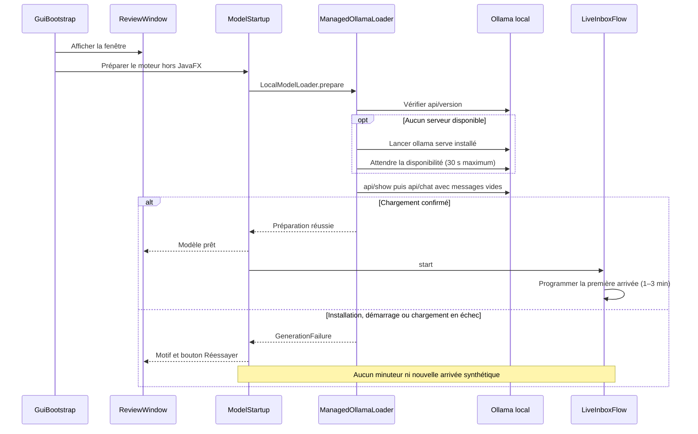
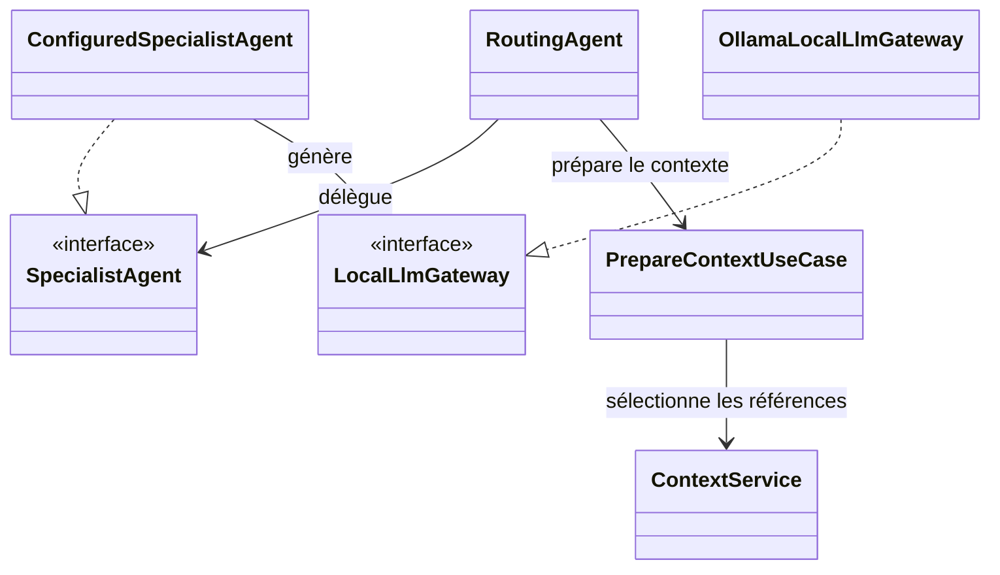

# Architecture de PayBridge

## Vue d’ensemble

Le projet est un monolithe Java en couches avec ports et adaptateurs, assemblé par le package `bootstrap`. La GUI JavaFX, les fichiers Properties, SQLite, Ollama et Gmail sont des adaptateurs ; le framework multi-agent générique ne dépend pas du métier paiement. Les agents échangent des tâches et résultats typés dans le même processus, sans microservices.

| Couche | Responsabilités et composants actuels | Dépendances |
| --- | --- | --- |
| `domain` | Emails, fils, agents, contexte, décisions, résultats de génération, versions de brouillon et statuts de livraison ; invariants et objets immuables | Aucune dépendance vers JavaFX, JDBC, HTTP ou le métier de démonstration |
| `application` | Routage, autorisation/sélection de contexte, orchestration `RoutingAgent`, relecture, envoi contrôlé, `ModelStartup` et `LiveInboxFlow` | Domaine et ports applicatifs |
| `adapters.inbound` | GUI JavaFX et présentateurs, console, lecture des fixtures synthétiques | Cas d’usage/ports et données du domaine ; aucune décision métier dans les contrôles graphiques |
| `adapters.outbound` | Configuration et sources locales, dépôts en mémoire/SQLite, client Ollama et processus local, messagerie simulée et connecteur Gmail | Implémentation des ports ; bibliothèques techniques confinées aux adaptateurs |
| `bootstrap` | Construction des dépendances, choix du mode, exécuteurs, minuteur et fermeture des ressources | Assemblage des couches sans transférer la logique métier dans le démarrage |

Le parcours reste **email reçu → routeur → spécialiste → LLM local → routeur → brouillon à relire**. Le classement de la boîte ne déclenche pas un envoi. Seule une validation humaine du contenu exact et des destinataires permet une transmission ; toute modification invalide cette validation.

### Démarrage graphique et cycle du moteur

Le port `LocalModelLoader` sépare la préparation d’un modèle de la génération via `LocalLlmGateway`. `ManagedOllamaLoader` est un décorateur de préparation : il réutilise ou démarre le serveur, puis délègue le préchargement. Le premier email attend la réussite de ces deux opérations. Cette préparation s’applique aux modes graphiques avec LLM actif ; seuls les modes de flux local créent un minuteur. Gmail et les fixtures statiques ne deviennent pas un flux synthétique.

L’exécuteur du modèle réalise les appels bloquants et le démarrage de processus ; JavaFX reçoit les événements par `Platform.runLater`. Une file de travail distincte assure les opérations applicatives de l’interface et du flux, dont les écritures locales ; le minuteur ne fait qu’y déposer les arrivées. Aucune transaction SQLite n’est maintenue pendant un appel LLM ou une transmission.

La fermeture annule le préchargement et le flux, arrête les minuteurs et ferme les exécuteurs/la session. Un résultat tardif ne redémarre pas le flux. Un processus lancé mais encore en attente est nettoyé en cas d’échec ou d’annulation ; un serveur prêt reste en arrière-plan pour les sessions suivantes. Un serveur préexistant n’est jamais arrêté. Il n’y a ni installation ni téléchargement automatique de modèle.

## Organisation des agents

Les définitions sont chargées depuis `config/agents/` et leurs prompts depuis `config/prompts/`. Les noms et catégories appartiennent à la configuration de démonstration, pas au noyau générique.

| Agent | Responsabilité |
| --- | --- |
| CommercialAgent | Qualifier les demandes d’offres et de tarification à partir des références autorisées |
| IntegrationAgent | Accompagner l’intégration technique et demander les informations nécessaires au diagnostic |
| OnsiteSupportAgent | Qualifier une demande d’accompagnement sur site sans confirmer une disponibilité |
| AccountAdminAgent | Traiter les questions administratives dans le périmètre du client concerné |
| GenericAgent | Clarifier les demandes sans spécialiste suffisamment pertinent |

`RouteEmailUseCase` applique une stratégie injectée. `RuleBasedRoutingStrategy` combine les indices déclarés dans les règles et produit un classement explicable. Une ambiguïté nécessite une correction humaine avant génération. Le routeur vérifie que l’agent retenu est actif et autorisé. La décision d’origine et ses corrections sont conservées.

`RoutingAgent` prépare la tâche avec le contexte autorisé, délègue à un `ConfiguredSpecialistAgent`, puis vérifie et publie le résultat corrélé. Les spécialistes ne s’appellent pas directement et ne disposent d’aucun accès global aux autres contextes.

## Autorisation, contexte et mémoire

Le périmètre client provient d’une association approuvée et ne peut pas être élargi par le contenu d’un email. Les autorisations de client, projet, visibilité, agent et destinataires sont filtrées avant lecture du texte et sélection par pertinence. Les sources internes et celles d’un autre client ne peuvent pas entrer dans une réponse client.

`ContextService` assemble les instructions, le message courant, une mémoire bornée, les extraits autorisés et le retour de régénération. La sélection est lexicale par paragraphe, déterministe et dédupliquée. Le budget réserve des tokens pour la sortie et inclut les instructions communes ; un contexte incompressible trop volumineux est refusé.

`ContextPromptFormatter` sépare les instructions des données échappées. Les emails, historiques et documents restent des données non fiables et ne modifient pas les permissions. La mémoire concerne uniquement le même fil et le même périmètre. Les brouillons, rejets, approbations sans transmission et envois simulés ne constituent pas des faits envoyés. Seuls les instantanés confirmés d’un transport réel peuvent enrichir cette mémoire comme réponses transmises.

## Cycle de vie d’un brouillon

Une génération réussie crée une version non approuvée. Le contenu et les destinataires sont figés dans chaque version. Une édition effective crée une nouvelle version et invalide l’approbation précédente. Le rejet conserve le texte et le retour éventuel ; la régénération n’écrase pas l’historique.

`SendApprovedReplyUseCase` vérifie l’approbation de la version courante, le périmètre et les destinataires avant de réserver une tentative. La réservation précède l’appel au transport, sans maintenir une transaction pendant cet appel. Une demande répétée retrouve la tentative existante ; un échec certain peut donner lieu à une nouvelle tentative explicite.

| Statut | Signification |
| --- | --- |
| PENDING | Transmission réservée et en cours ; édition et double transmission bloquées |
| SIMULATED | Contenu approuvé enregistré dans la boîte locale, sans livraison réelle |
| CONFIRMED | Acceptation confirmée par un transport réel ; aucune preuve de lecture du destinataire |
| FAILED | Le transport garantit l’absence de livraison ; reprise explicite possible |
| UNKNOWN | Résultat indéterminé ; aucune relance automatique |

## Persistance et reprise

Les ports de dépôt séparent les agrégats de leurs adaptateurs en mémoire ou SQLite. `SqliteStore` gère la connexion, les migrations, les transactions et l’assemblage des dépôts. Les révisions protègent les mises à jour contre les vues obsolètes. Les configurations, sources, décisions et générations conservent leurs versions et reçus.

Le schéma courant est **6**. Une base étrangère ou de version inconnue est refusée sans réinitialisation. Les migrations sont transactionnelles. La reprise d’une session marque les travaux interrompus et les transmissions incertaines sans inventer de succès ni relancer un envoi.

La migration des anciens contenus de démonstration archive puis retire uniquement les réponses fixes simulées inchangées, sans tentative de transport réel. Les modifications humaines et les générations encore référencées sont conservées. L’archive n’est pas exposée dans les dossiers actifs.

Les instantanés sont en clair. Le journal de diagnostic contient des identifiants, révisions, motifs et horodatages ; aucun corps d’email n’y est enregistré par défaut. Le modèle de confiance est celui d’un utilisateur local disposant des droits sur le dossier.

## Frontières techniques

`OllamaLocalLlmGateway` utilise exclusivement une adresse HTTP loopback validée, sans proxy ni redirection. Il vérifie les métadonnées du modèle local et sa capacité avant l’envoi du contexte. La préparation utilise une requête sans message ; la génération conserve les rôles séparés. Une réponse absente, invalide ou interrompue ne produit pas de brouillon valide.

`ManagedOllamaLoader` décore la préparation par la vérification et le démarrage du processus installé. L’exécutable est recherché dans PATH puis dans l’emplacement Windows standard. `ProcessBuilder` ne lance aucun shell ; les variables du processus fixent l’adresse locale, le stockage de modèles du projet et la désactivation du cloud/debug. Les tests injectent les opérations de processus, de disponibilité et de temps.

`GmailClient`, `GmailMailbox` et `GmailEmailSender` isolent le protocole fournisseur derrière les ports applicatifs. L’authentification OAuth passe par le navigateur système et un rappel loopback. La réception est bornée, les identifiants sont isolés par compte et les changements distants sont explicites. Les erreurs sont traduites sans exposer de réponse brute ou de secret. Le connecteur est testé avec doublures ; son parcours réel reste à valider. Le [guide Gmail](docs/INTERFACE_ET_GMAIL.md) précise ses limites.

## Patterns utilisés

| Pattern | Application et justification |
| --- | --- |
| Strategy | Remplacer la politique de routage ou de sélection sans changer les cas d’usage |
| Adapter | Isoler JavaFX, HTTP, les fichiers, SQLite et Gmail du domaine |
| Repository | Conserver les agrégats sans coupler les cas d’usage à SQL |
| Factory simple | Créer un spécialiste à partir d’une définition validée |
| Mediator | Centraliser les tâches et résultats dans le coordinateur sans couplage direct des spécialistes |
| Decorator | Ajouter le démarrage d’Ollama autour du port de préchargement |
| Facade | Fournir aux présentateurs une API de travail via `ReviewWorkspaceService` |

Les objets du domaine sont immuables et les interfaces sont placées aux frontières effectivement substituables. L’architecture évite les microservices et les abstractions de stockage génériques sans usage.

## Extensibilité

Un nouveau spécialiste se décrit par son rôle, son prompt, ses sources et ses règles de routage. Un moteur utilisant un autre protocole nécessite un adaptateur de `LocalLlmGateway` et, si nécessaire, de `LocalModelLoader`. Un stockage alternatif implémente les ports de dépôt et leurs garanties transactionnelles. Ces évolutions doivent préserver l’isolation des clients, la corrélation des résultats et la validation exacte avant transmission.

Les tests unitaires utilisent horloges et exécuteurs contrôlés, dépôts en mémoire et fournisseurs de test. Les intégrations HTTP/SQLite et les essais avec un modèle réel sont séparés. Les résultats de génération ne sont pas comparés à une chaîne exacte dans les tests unitaires.

## Décisions de conception

| Question du §14 | Décision et justification |
| --- | --- |
| 1. Qu'est-ce qu'un agent ? | Entité logicielle identifiable avec rôle, instructions, connaissances autorisées et contrat tâche/résultat ; pas nécessairement un processus autonome |
| 2. Quelles responsabilités ? | Routeur : orientation et coordination ; spécialiste : proposition dans son rôle ; contrôle de validation et infrastructure séparés |
| 3. Quelles informations possède-t-il ? | Définition versionnée et contexte autorisé sélectionné pour la tâche ; aucun accès implicite à tous les clients |
| 4. Comment communiquent-ils ? | Messages typés `AgentTask` / `AgentResult` corrélés, transmis dans le même processus |
| 5. Comment choisir un agent ? | Stratégie configurable multi-indices, motifs et classement ; adresse seule insuffisante |
| 6. Plusieurs agents adaptés ? | Ambiguïté déclarée selon la marge ; décision humaine dans le socle ; coopération multiagents possible plus tard |
| 7. Aucun agent adapté ? | GenericAgent et clarification, sans invention de catégorie ou de contexte |
| 8. Représentation des contextes ? | Sources locales versionnées avec portée, visibilité et provenance ; résultat sélectionné `ContextBundle` |
| 9. Historique de conversation ? | Événements typés et versions persistées, avec distinction stricte brouillons/réponses envoyées |
| 10. Limiter le contexte ? | Autoriser puis sélectionner/dédupliquer, budget avec réserve de sortie et mémoire bornée |
| 11. Ajouter un agent ? | Enregistrement d'une définition, prompt, règles et sources, sans modifier substantiellement le noyau |
| 12. Changer de LLM ? | Configuration pour un modèle compatible ; nouvel adaptateur si le protocole change |
| 13. Quelles données persistantes ? | Agents/prompts et versions, sources et références, emails/fils, décisions, brouillons, retours, approbations et tentatives d'envoi |
| 14. Avantages et limites ? | Spécialisation, isolation et explicabilité ; coût d'orchestration, erreurs de routage, budget local, hallucinations, injections et maintenance des contextes ; bénéfices à mesurer |

