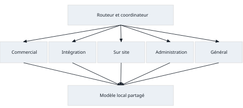
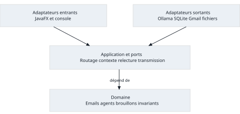
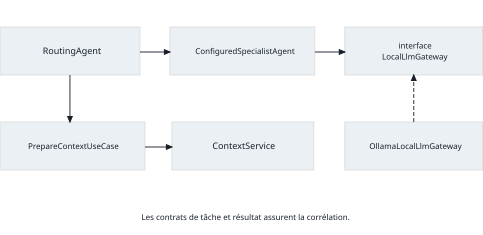
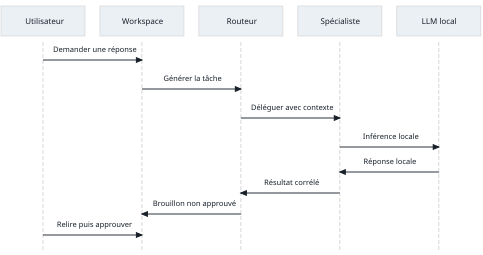

# PayBridge

## Framework multi agent de rédaction d’emails B2B

Rapport de projet — Systèmes multi-agents — Master 2

Version du 13 novembre 2026

**Identification du groupe à compléter.** Les noms, numéros étudiants et contributions n’ont pas été fournis. Ils doivent être renseignés dans la section `Contributions of group members` avant le dépôt.

## Résumé

PayBridge est un framework Java d’assistance à la rédaction d’emails, appliqué à une startup proposant un service de paiement B2B et un accompagnement à son intégration. Un routeur explicable sélectionne un spécialiste selon le message et son historique. Le spécialiste reçoit un prompt propre à son rôle et un contexte filtré par autorisation, puis sollicite un modèle de langage local. La proposition est conservée comme brouillon versionné ; son contenu et ses destinataires doivent être approuvés avant transmission.

Le projet comprend une interface JavaFX, un stockage SQLite, un adaptateur Ollama et une messagerie locale de démonstration. Un connecteur Gmail facultatif est implémenté mais son fonctionnement sur un compte réel reste à valider. Le moteur est démarré et le modèle préchargé avant les arrivées synthétiques.

La suite standard comporte 559 tests réussis. Un parcours réel sur vingt emails synthétiques a produit vingt brouillons sans erreur technique et sans envoi. L’analyse de ce lot montre néanmoins que trois réponses dépassent la consigne de 120 mots. La durée médiane du gateway est de 6,07 secondes. Ces résultats établissent le fonctionnement du parcours, sans démontrer la supériorité de l’approche multi-agent ni l’exactitude métier des réponses. Une comparaison contrôlée et une annotation qualitative indépendante restent nécessaires.

## Plan de lecture

Les sections 1 à 16 présentent successivement le problème, les objectifs, l’organisation, l’architecture, les choix de conception, les classes, les communications, le routage, le contexte, les fils, le LLM, les patterns, les expériences, les résultats, les limites et les améliorations. La fin du rapport contient les contributions, les réponses aux quatorze questions de conception et les références.

## 1 Problème étudié

Une startup qui fournit une solution de paiement reçoit des demandes de nature différente : offres commerciales, difficultés d’intégration, suivi administratif ou besoin d’un intervenant sur site. Un même interlocuteur peut aborder plusieurs de ces sujets au cours de fils distincts. Associer durablement une adresse à une seule catégorie ne suffit donc pas.

Une réponse utile doit mobiliser les bonnes connaissances sans confondre les dossiers de clients différents. Elle doit aussi distinguer les informations approuvées des engagements qui exigent une décision opérationnelle. Par exemple, une demande de présence d’un ingénieur ne permet pas de confirmer sa disponibilité ou son affectation. Une question sur les frais ne justifie pas d’inventer un tarif absent des références.

Le problème étudié est la préparation de réponses contextualisées, explicables et contrôlables. Le traitement des paiements, l’intégration effective d’un service financier et la réservation de personnel sont hors périmètre. PayBridge est une application académique et les données livrées sont synthétiques.

## 2 Objectifs du système

Le premier objectif est de séparer les responsabilités de routage et de rédaction afin que chaque spécialiste dispose d’un rôle identifiable. Le deuxième est de limiter le contexte envoyé au modèle aux données pertinentes et autorisées. Le troisième est de garder le contrôle humain sur le message réellement transmis, tout en conservant les versions et les décisions.

Le framework doit permettre l’ajout d’agents, la modification des prompts et des sources, ainsi que le remplacement du moteur, du stockage ou de la stratégie de routage. La généricité se situe dans les contrats et les cas d’usage ; les noms et catégories PayBridge appartiennent à la configuration.

Les critères vérifiables sont le parcours reçu–routeur–spécialiste–LLM–routeur–utilisateur, l’isolation des clients, la gestion d’une ambiguïté, la création de brouillons non approuvés et l’absence d’envoi sans validation du contenu exact. Aucun objectif chiffré de qualité rédactionnelle n’est présenté comme atteint sans mesure indépendante.

## 3 Organisation multi agent

Le système retient une organisation centralisée. `RouteEmailUseCase` produit la décision de sélection ; `RoutingAgent` coordonne la préparation du contexte, la délégation et le retour du résultat. Les spécialistes ne s’appellent pas directement et ne partagent pas un espace documentaire sans contrôle.

| Agent | Responsabilité | Connaissances principales |
| --- | --- | --- |
| CommercialAgent | Qualifier les demandes d’offres et de frais | Présentation du service et références commerciales autorisées |
| IntegrationAgent | Accompagner le diagnostic d’intégration | Documentation technique et dossier du client autorisé |
| OnsiteSupportAgent | Qualifier le besoin d’accompagnement sur site | Procédure de qualification et informations partageables |
| AccountAdminAgent | Traiter les questions administratives | Références administratives du bon client |
| GenericAgent | Clarifier les demandes générales | Présentation publique approuvée |

La spécialisation ne repose pas uniquement sur un nom de prompt. Chaque définition possède une identité, une version, un rôle, des catégories, un prompt système et des références de contexte. La sélection, l’autorisation des sources et les reçus de génération rendent cette organisation observable. Le moteur local peut toutefois être partagé entre les agents.

Les agents sont des objets logiciels exécutés dans un même processus, et non des services autonomes distribués. Cette limite simplifie la maîtrise des ressources et la reprise locale. La coopération de plusieurs spécialistes sur un même message n’est pas implémentée : une demande ambiguë sollicite l’utilisateur.

## 4 Architecture générale

L’application est un monolithe Java en couches, organisé selon une séparation entre domaine, application et adaptateurs. Le package `bootstrap` assemble les dépendances et possède le cycle de vie des ressources. Cette structure évite de coupler les règles de brouillon à JavaFX, SQL ou au protocole Ollama.

| Couche | Responsabilités | Dépendances autorisées |
| --- | --- | --- |
| Domaine | Emails, périmètres, décisions, versions et invariants | Bibliothèque standard Java |
| Application | Cas d’usage, ports, routage et orchestration | Domaine et contrats applicatifs |
| Adaptateurs | Interface, fichiers, SQLite, HTTP et Gmail | Contrats applicatifs et domaine |
| Assemblage | Construction, choix des modes, exécuteurs et fermeture | Composants nécessaires à l’assemblage |

La lecture et le classement des emails ne déclenchent pas directement le LLM. Le flux temporisé appelle les cas d’usage ; la fenêtre reçoit des états de présentation et des événements. Les opérations bloquantes sont réalisées hors du thread JavaFX. Les transactions de stockage ne restent pas ouvertes pendant une inférence ou une transmission.

La persistance est assurée par SQLite, sans serveur SQL externe. La configuration initiale est fournie par fichiers ; après sauvegarde graphique, l’instantané de la base sélectionnée devient prioritaire. Ce choix permet une démonstration reproductible tout en conservant les configurations réellement utilisées.

## 5 Choix de conception

Le choix d’un monolithe est proportionné à un premier framework local : il évite les défaillances réseau entre agents et le coût de déploiement de microservices. Il ne dispense pas de contrats explicites, car le routage, le contexte, la génération et la transmission ont des responsabilités distinctes.

Le routage utilise des règles déclaratives plutôt qu’un appel supplémentaire au LLM. Il est déterministe, inspectable et peu coûteux. En contrepartie, il dépend du vocabulaire configuré et ne mesure pas la compréhension sémantique d’un message. Le score est un score de correspondance, pas une probabilité de justesse.

Le choix d’un petit modèle local facilite l’exécution sur une machine de ressources limitées et maintient les données sur le poste. Il réduit aussi la qualité de certaines formulations. Le rejet d’une réponse incomplète et la validation humaine sont donc des décisions structurantes, pas des corrections cosmétiques.

Les agrégats immuables et les révisions optimistes limitent les écrasements depuis une vue obsolète. Les interfaces sont placées aux frontières qui doivent être substituables. Une migration conserve les données humaines et l’historique de transport au lieu de réinitialiser la base pour simplifier un changement de version.

## 6 Classes et interfaces importantes

| Composant | Rôle dans le parcours |
| --- | --- |
| AgentDefinition et AgentRegistry | Définition versionnée, agents actifs et publication atomique du registre |
| RoutingStrategy et RuleBasedRoutingStrategy | Contrat et implémentation du classement explicable |
| RouteEmailUseCase et RoutingAgent | Décision de routage puis coordination des tâches |
| PrepareContextUseCase et ContextService | Autorisation, sélection et budget du contexte |
| SpecialistAgent et ConfiguredSpecialistAgent | Contrat et comportement du spécialiste configuré |
| LocalLlmGateway et LocalModelLoader | Génération et préparation du modèle, séparées |
| Draft et DraftReviewService | Versions, édition, rejet, approbation et régénération |
| SendApprovedReplyUseCase et EmailSender | Garde applicative et frontière de transmission |
| ModelStartup et LiveInboxFlow | Barrière de préparation, arrivées et file de rédaction |
| SqliteStore et dépôts | Transactions, migrations et restauration durable |

Les présentateurs utilisent des interfaces de travail plutôt que des objets JDBC ou HTTP. Les adaptateurs en mémoire permettent les tests déterministes ; les adaptateurs concrets implémentent les mêmes frontières sans déplacer les invariants hors du domaine.

## 7 Communication entre agents

La communication utilise des objets typés `AgentTask` et `AgentResult`, corrélés par l’identifiant de tâche. La tâche contient la définition du spécialiste et une requête de génération préparée. Le résultat distingue une réussite, un échec, une annulation ou un résultat remplacé. Une réussite comporte une proposition et son reçu ; un échec ne contient pas de texte présenté comme valide.

Le coordinateur vérifie l’identité de la tâche, le modèle attendu et la validité du contexte avant publication. Un changement de registre ou de routage peut rendre une réponse obsolète. Une annulation ou une réussite tardive ne doit pas créer un brouillon après fermeture du parcours.

Les échanges restent en mémoire dans le même processus. La base conserve les résultats et leurs références, mais ne sert pas de bus de communication entre agents. L’ajout d’un transport distribué exigerait de nouveaux contrats de livraison, de sécurité et de reprise ; il n’est pas nécessaire au périmètre actuel.

## 8 Stratégie de routage

Les règles sont chargées depuis la configuration. La démonstration combine notamment sujet, corps et historique récent. Les textes sont normalisés ; chaque règle contribue au plus une fois par agent. Les candidats sont ordonnés par score puis identifiant, ce qui rend le résultat déterministe.

La politique fournie utilise un seuil de 3, une marge d’ambiguïté de 1 et une fenêtre de six messages antérieurs. Si deux spécialistes sont trop proches, le système déclare l’ambiguïté. Si aucun spécialiste n’est suffisamment adapté, l’agent de repli autorisé prend en charge la clarification. Aucun résultat de stratégie ne peut élargir l’ensemble des agents autorisés.

La décision initiale, ses motifs et ses corrections sont conservés. L’utilisateur peut confirmer un autre spécialiste sans effacer l’origine du classement. L’adresse d’un expéditeur constitue au plus un indice configuré, jamais une preuve suffisante de catégorie ou d’autorisation d’accès aux documents d’un client.

Sur le lot synthétique analysé, les vingt agents retenus correspondent aux catégories attendues. Ce résultat ne mesure pas une précision généralisable : les règles et les messages proviennent de la même démonstration et le lot ne contient pas de demande mixte destinée à éprouver l’ambiguïté.

## 9 Gestion du contexte

Le système filtre les autorisations avant d’ouvrir le texte des sources. Une source doit correspondre au périmètre client et projet, à l’agent et à tous les destinataires de réponse. Les documents `INTERNAL_ONLY` ne sont pas transmis dans une réponse client. Un expéditeur inconnu ne reçoit pas de droits privés parce que son email les revendique.

Après filtrage, la sélection lexicale travaille par paragraphes et élimine les doublons. `ContextPromptFormatter` sépare les instructions des données échappées. Les emails, historiques et documents importés restent non fiables ; ils ne modifient ni le rôle ni les permissions du spécialiste.

Le budget inclut les instructions communes, le message courant, les extraits, la mémoire et une réserve de sortie. Le compteur préalable compte les octets UTF-8 : c’est une estimation conservatrice, pas le tokenizer du modèle. Les nombres de tokens retournés par Ollama sont des mesures distinctes. Si les éléments incompressibles dépassent le budget, le contexte est refusé plutôt que tronqué silencieusement.

La sélection lexicale est explicable et légère, mais peut manquer des paraphrases ou privilégier une correspondance de mots peu utile. Une recherche vectorielle locale pourrait améliorer la pertinence ; elle ne devrait jamais remplacer le filtrage préalable des droits.

## 10 Gestion des fils et de la mémoire

Une conversation possède un identifiant, un périmètre et un historique d’événements. Les agrégats refusent un ajout qui mélange deux clients. La mémoire sélectionnée concerne uniquement les messages antérieurs du même fil et partageables avec les destinataires de réponse.

Les messages reçus peuvent fournir des faits conversationnels. Une réponse ne devient un fait effectivement transmis que si le transport réel est confirmé. Une approbation seule, un brouillon, un rejet ou un envoi simulé ne prouve pas qu’un client a reçu ce contenu. Cette distinction évite qu’une nouvelle génération raisonne sur une promesse jamais envoyée.

Les brouillons sont versionnés séparément des échanges confirmés. L’édition invalide l’approbation et ne remplace pas le contenu d’une tentative déjà enregistrée. Au redémarrage, les données sont restaurées sans transmission automatique. Les travaux interrompus et les envois incertains sont identifiés explicitement ; aucun succès n’est déduit d’une fermeture anormale.

## 11 Intégration du modèle local

L’adaptateur Ollama n’accepte qu’une adresse HTTP loopback explicite. Il désactive les redirections et les proxys, vérifie les métadonnées du modèle et sa capacité, puis utilise une requête de chat dont les rôles sont séparés. Une réponse vide, malformée ou interrompue n’est pas publiée comme brouillon valide.

Au lancement graphique, `ManagedOllamaLoader` réutilise le serveur existant ou lance l’exécutable installé sans shell. Le processus utilise le stockage de modèles du projet et les fonctions cloud sont désactivées. `ModelStartup` attend la disponibilité puis le préchargement sans email. Le premier minuteur du flux est créé seulement après réussite ; une erreur laisse le flux en attente avec possibilité de réessai.

| Paramètre du parcours mesuré | Valeur |
| --- | --- |
| Modèle | qwen2.5:0.5b |
| Fenêtre demandée et sortie maximale | 8192 et 1024 tokens |
| Température et graine | 0,2 et 42 |
| Délai de génération | 120 secondes |
| Marge de protocole | 128 |
| Limitation des répétitions | repeat_penalty 1,15 et repeat_last_n 256 |
| Résidence mémoire demandée | 30 minutes, renouvelées après génération |

La fermeture annule la préparation et le flux. Un processus lancé mais encore indisponible est nettoyé en cas d’échec ou d’annulation ; un serveur prêt reste en arrière-plan et un serveur préexistant n’est jamais arrêté. L’application ne télécharge pas automatiquement un modèle. Le préchargement ne garantit pas qu’une génération ultérieure sera correcte ou terminée.

## 12 Design Patterns et justification

| Pattern | Utilisation réelle | Bénéfice et limite |
| --- | --- | --- |
| Strategy | RoutingStrategy et politiques de sélection | Remplacement d’une politique ; ne garantit pas sa pertinence |
| Adapter | Ollama, Gmail, fichiers et SQLite | Protocole technique isolé du domaine |
| Repository | Dépôts de conversations et brouillons | Cas d’usage indépendants de SQL ; garanties transactionnelles à préserver |
| Factory simple | Création du spécialiste depuis sa définition | Ajout sans branche métier dans le coordinateur |
| Mediator | Coordination par RoutingAgent | Retour centralisé sans couplage direct entre spécialistes |
| Decorator | ManagedOllamaLoader autour du préchargement | Ajout du démarrage de serveur sans changer le port de préparation |
| Facade | ReviewWorkspaceService pour la présentation | Interface de travail cohérente, invariants maintenus dans les cas d’usage |

Les états énumérés du brouillon ne sont pas présentés comme une implémentation du pattern State. De même, la présence de boutons ou de commandes console ne suffit pas à revendiquer le pattern Command. Les patterns servent les frontières effectivement utilisées ; leur nombre n’est pas un indicateur de qualité.

## 13 Expériences et méthode de validation

La validation distingue trois niveaux. Les tests unitaires utilisent des horloges, exécuteurs et fournisseurs contrôlés. Les intégrations vérifient SQLite et HTTP avec des ressources temporaires. Les parcours avec le modèle réel évaluent le fonctionnement du système assemblé, sans être intégrés à la suite standard déterministe.

Le dernier build vérifié exécute 446 tests unitaires ou petits parcours, 87 intégrations SQLite et 26 intégrations HTTP. Ils couvrent notamment le routage, les droits de contexte, les versions et approbations, la reprise, les erreurs fournisseur, la troncature, les délais, l’annulation et l’attente du moteur. Le profil de test réel reste volontaire et requiert un modèle déjà installé.

Le parcours réel principal utilise vingt emails synthétiques externes au noyau, quatre par catégorie. Les arrivées ont été accélérées à 1–3 secondes, explicitement annoncées dans l’interface, et les rédactions traitées en série. La base d’essai est distincte de la base utilisateur. Aucune approbation ou transmission n’a été déclenchée.

Les métriques sont recalculées depuis les résultats archivés, sans exporter les emails : nombre de résultats et de brouillons, agent retenu, durée du gateway, tokens retournés par Ollama et longueur lexicale des réponses. Le script `analyze_demo.py` produit `results.json`. Les mots sont comptés par une expression régulière Unicode qui conserve les apostrophes et traits d’union internes ; cette mesure n’est pas un jugement linguistique.

L’environnement consigné est Windows, JDK 25.0.2 avec compilation Java 21, Maven 3.9.9 et Ollama 0.40.15. Un contrôle technique antérieur du même poste indiquait environ 14,87 Go de mémoire physique et une exécution CPU du moteur ; ces éléments ne constituent pas une nouvelle mesure du matériel lors du lot. La graine fixe ne garantit pas une reproduction bit à bit sur une autre version ou machine.

Une comparaison multi-agent contre agent générique, ainsi que des ablations sans contexte ou sans mémoire, ne sont pas disponibles. Aucun gain chiffré n’est donc attribué à la spécialisation. Le protocole proposé pour compléter cette évaluation est présenté en section 16.

## 14 Résultats et interprétation

| Indicateur du lot réel | Résultat |
| --- | --- |
| Messages reçus et générations terminées | 20 et 20 |
| Brouillons non approuvés | 20 |
| Échecs ou générations encore actives à la fin | 0 |
| Approbations et tentatives de transmission | 0 et 0 |
| Agent conforme à la catégorie attendue | 20 sur 20, sur le corpus de démonstration |
| Réponses respectant 120 mots maximum | 17 sur 20, soit 85 % |

| Mesure | Minimum | Médiane | Moyenne | Maximum |
| --- | --- | --- | --- | --- |
| Durée du gateway en secondes | 1,51 | 6,07 | 7,57 | 33,45 |
| Tokens d’entrée | 393 | 580 | 597,45 | 884 |
| Tokens de sortie | 36 | 158 | 175,25 | 739 |
| Mots par réponse | 25 | 91,5 | 96,25 | 406 |

Chaque agent a traité quatre messages. La génération terminée sur les vingt cas démontre que le routage, l’inférence et la capture des brouillons peuvent fonctionner ensemble. La durée mesurée comprend les appels du gateway, dont la vérification du modèle ; elle exclut l’attente avant arrivée et la totalité de la latence perçue depuis réception.

Le dépassement de longueur sur trois réponses montre que la consigne textuelle n’est pas une contrainte dure. La réponse la plus longue atteint 406 mots malgré une sortie techniquement complète. Il serait incorrect d’assimiler le taux de succès technique de ce lot à un taux de réponses satisfaisantes.

Des contrôles antérieurs ont révélé des sorties interrompues et des réponses hors sujet ou maladroites. Le renforcement des consignes et des paramètres de répétition a été suivi d’un lot complet sans échec. Cependant, un essai isolé après modification était encore incomplet. Le corpus, l’ordre d’arrivée et plusieurs conditions n’étant pas contrôlés comme une expérience comparative, ces observations ne permettent pas d’estimer un effet causal de la correction.

La preuve principale est donc une capacité fonctionnelle mesurée, accompagnée de limites observables. La pertinence, la fidélité aux références et l’absence de promesses indues demandent encore une annotation humaine indépendante.

## 15 Limites de la solution

Le modèle de 0,5 milliard de paramètres ne permet pas de garantir une rédaction professionnelle ou factuellement correcte. Une réponse complète peut rester imprécise, trop longue ou mal formulée. Le contrôle humain reste nécessaire pour le contenu exact et pour les destinataires.

Le corpus mesuré est réduit, synthétique et lié au vocabulaire des règles. Il ne constitue ni un test indépendant de généralisation ni une mesure robuste sur des demandes ambiguës, adversariales ou multilingues. Aucun intervalle de confiance ou avantage sur un agent générique n’est revendiqué. Les 559 tests ne sont pas un taux de couverture, qui n’a pas été mesuré.

La protection du contexte dépend aussi de la classification humaine des documents et des associations de clients. L’échappement des données et la séparation des rôles réduisent certains risques d’injection sans démontrer leur élimination. Le stockage local est en clair et suppose un utilisateur de confiance ; il n’existe pas d’administration multi-utilisateur complète.

Le connecteur Gmail a été testé avec doublures, sans consentement ou envoi sur un compte réel. L’import est borné et actualisé manuellement. Les pièces jointes, la composition indépendante d’un email, les labels personnalisés et la réconciliation automatique des transmissions incertaines ne sont pas implémentés. Le fonctionnement natif JavaFX a été contrôlé sous Windows ; les autres plateformes et l’exécution sur un JDK 21 demandent une validation distincte.

## 16 Améliorations et protocole comparatif

La priorité est une évaluation contrôlée sur un corpus figé et indépendant, contenant les cinq catégories, des demandes mixtes, des changements de sujet et des tentatives d’accès interclient. Les références attendues et les réponses acceptables doivent être annotées avant exécution. La partition d’évaluation ne doit pas servir à ajuster les règles.

Trois configurations peuvent être comparées avec le même modèle et les mêmes limites : spécialiste avec contexte autorisé, agent générique avec le même ensemble autorisé, puis spécialiste sans extraits documentaires. Une ablation de mémoire complète l’analyse sur les fils. Il faut séparer l’effet de la sélection du contexte de celui du prompt de rôle et ne jamais modifier les autorisations pour une comparaison.

Les mesures proposées sont la matrice de confusion du routage, le taux d’abstention sur ambiguïté, la fidélité aux références, la pertinence, les engagements non fondés, le respect de la longueur, les erreurs techniques et les durées. Une grille commune et, si possible, deux évaluateurs permettent d’expliciter les désaccords. Les répétitions doivent conserver les versions, graines, paramètres et conditions matérielles.

Sur le plan technique, un modèle local plus capable pourrait être comparé au modèle actuel avant toute substitution par défaut. Une recherche sémantique locale, une mémoire résumée, un spécialiste critique ou une coopération encadrée peuvent être étudiés si leurs bénéfices sont mesurés. La validation Gmail sur compte de test et la gestion explicite des envois incertains constituent des travaux séparés. Aucune de ces améliorations ne doit contourner l’autorisation du contexte ou l’approbation du contenu exact.

## Contributions of group members

Les informations d’identité et de contribution n’ont pas été communiquées. Le tableau doit être complété pour chaque membre avec les travaux réellement effectués avant remise du rapport. Les contributions devront refléter la participation effective de chaque membre.

| Prénom et nom | Numéro étudiant | Parties prises en charge et contributions réelles |
| --- | --- | --- |
| À renseigner | À renseigner | À renseigner pour chaque membre du groupe |

Le sujet prévoit un seul dépôt par groupe et exige la liste complète des membres avec leurs numéros étudiants.

## Annexe Réponses aux quatorze questions de conception

1. **Qu’est ce qu’un agent dans cette architecture ?** Un objet logiciel identifiable par une définition versionnée, un rôle, un prompt et des sources autorisées. Son exécution est encadrée par un contrat de tâche et de résultat.
2. **Quelles sont ses responsabilités ?** Le routeur sélectionne et coordonne ; le spécialiste rédige dans son domaine. Les décisions d’approbation, les écritures et le transport restent dans des composants distincts.
3. **Quelles informations possède t il ?** Le spécialiste reçoit un instantané de sa définition et le contexte préparé pour la tâche, sans accès global aux dossiers des clients.
4. **Comment les agents communiquent ils ?** Par `AgentTask` et `AgentResult` corrélés, dans le même processus. Aucun appel direct entre spécialistes n’est nécessaire.
5. **Comment déterminer le bon agent ?** Par une stratégie injectée, qui combine des règles sur le contenu et l’historique, puis applique seuil, marge et vérification des permissions.
6. **Que se passe t il si plusieurs agents conviennent ?** Une ambiguïté est explicitée et l’utilisateur choisit le spécialiste avant génération.
7. **Que se passe t il si aucun agent ne convient ?** L’agent de repli actif et autorisé prépare une clarification. L’absence de repli admissible conduit à un refus explicite.
8. **Comment représenter les contextes ?** Par des sources versionnées avec portée, visibilité, provenance et destinataires, puis un `ContextBundle` sélectionné et budgété.
9. **Comment gérer l’historique ?** Par conversation et périmètre, avec événements typés et distinction entre reçu, brouillon et contenu réellement transmis.
10. **Comment éviter trop de contexte ?** Autoriser avant de lire, sélectionner et dédupliquer les paragraphes, borner la mémoire et réserver le budget de sortie. Le compteur préalable reste une estimation.
11. **Comment ajouter un agent ?** Ajouter une définition, un prompt, des références de sources et des règles ; l’orchestrateur générique n’a pas à connaître le nouveau métier.
12. **Comment changer de LLM ?** Modifier le modèle et les paramètres pour un protocole compatible, ou implémenter les ports de préparation/génération et adapter l’assemblage pour un autre moteur local.
13. **Quelles données persistent ?** Emails, conversations, configurations et versions, sources, décisions, résultats et reçus, brouillons, retours, approbations et tentatives de transmission.
14. **Quels avantages et limites ?** Spécialisation observable, isolation et explicabilité, au prix d’une orchestration supplémentaire et de configurations à maintenir. Les gains qualitatifs sur un agent générique restent à démontrer.

## Références et reproductibilité

- Sujet académique fourni par l’enseignant, *Multi Agent Systems Project*, sections 12 à 18, notamment les questions de conception et les livrables, pages 7 à 9.
- [Architecture de PayBridge](../../ARCHITECTURE.md) et [instructions d’exécution](../../README.md).
- [Bilan du préchargement réel](../experiments/I19-auto-start-ollama.md), [bilan du flux réel](../experiments/I20-generation-truncation.md) et [observations initiales du modèle](../experiments/I05-local-smoke.md).
- [Résultats descriptifs recalculés](results.json) et [script d’analyse](analyze_demo.py). La base locale n’est pas distribuée ; les emails synthétiques et la configuration permettent de rejouer un nouveau lot, dont les durées et sorties peuvent varier.
- Sources du projet dans `src/main/java` et tests dans `src/test/java`, accessibles depuis la racine du dépôt. Le rapport décrit les composants réellement implémentés ; le protocole comparatif de la section 16 n’est pas présenté comme exécuté.

Pour recalculer les métriques sur une base synthétique contenant les générations archivées, exécuter depuis la racine : `python docs/report/analyze_demo.py --database data/runtime/i20-live-generation.sqlite --output docs/report/results.json`. Le script lit la base en mode lecture seule et exporte uniquement des agrégats, sans corps d’email ni réponse.
